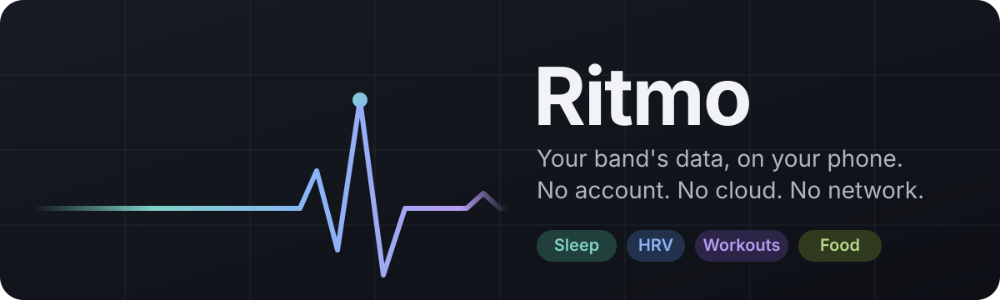
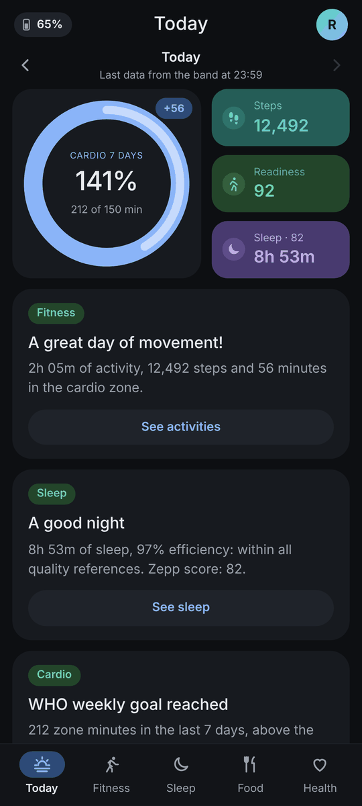
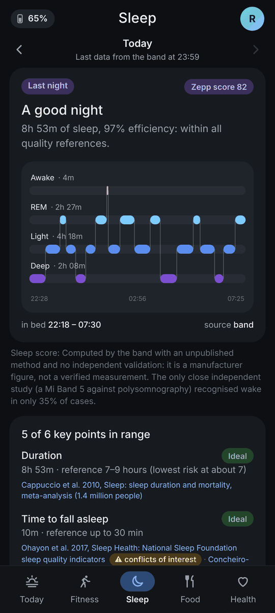
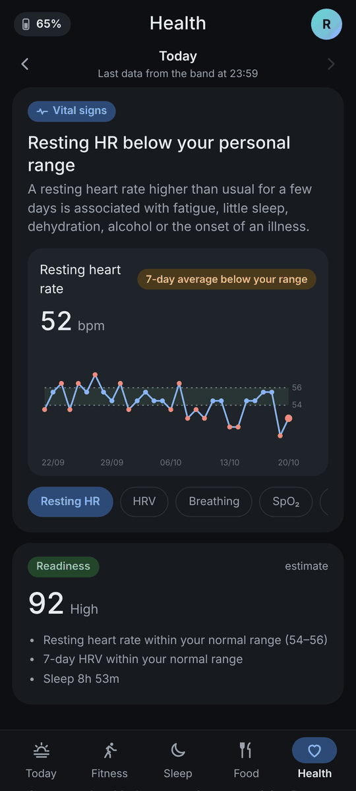
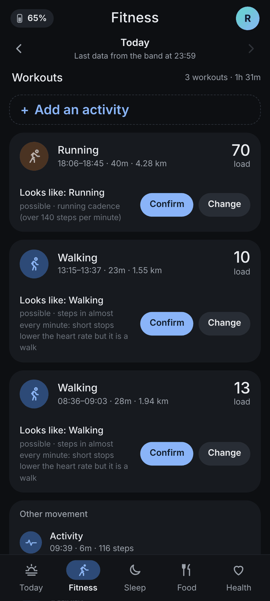
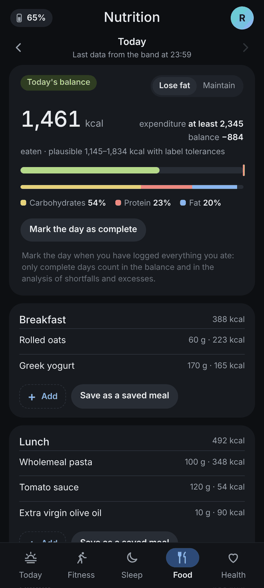
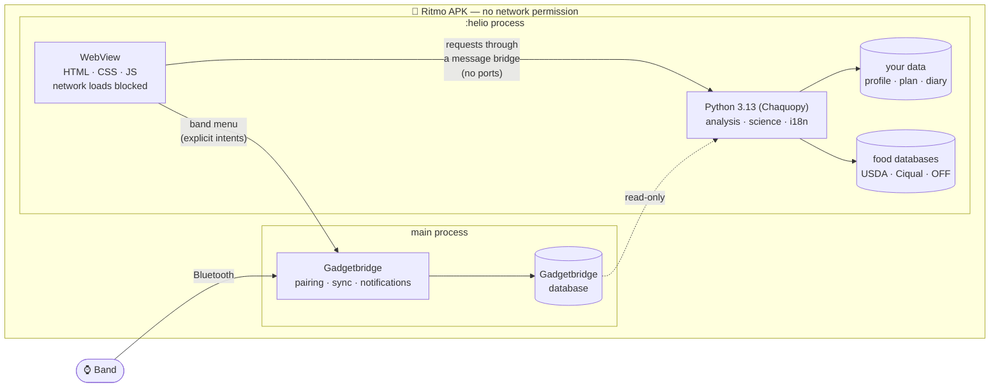

<p align="center">
  
</p>

<p align="center">
  <a href="https://github.com/compassionee/ritmo/releases/latest"></a>
  
  
  
  <a href="LICENSE"></a>
</p>

**Ritmo** is an Android app to see and understand the data of a heart rate band: sleep, resting heart
rate, HRV, SpO₂, stress, steps, workouts, calories, nutrition and weight. It works **without an
account and without network, in any case**: the app has no network permission and the data stays on
the phone. Every value comes with the published study or guideline it is compared against.

<p align="center">
  
  
  
  
  
</p>
<p align="center"><sub>Today · Sleep · Health · Fitness · Food — screenshots taken on synthetic data</sub></p>

## Contents

- [Features](#-features)
- [Installation](#-installation)
- [First setup](#-first-setup)
- [How it works](#-how-it-works)
- [Privacy](#-privacy)
- [Building from source](#-building-from-source)
- [Publishing a release](#-publishing-a-release)
- [Translations](#translations) · [Licences](#licences)

## ✨ Features

| | |
|---|---|
| 🌙 **Sleep** | stages of the night, time to fall asleep, efficiency and regularity, each against a published reference |
| ❤️ **Health** | resting heart rate, HRV, breathing rate, SpO₂ and temperature against *your* normal range, plus a readiness estimate |
| 🏃 **Fitness** | workouts recognised from steps and heart rate (walking, running, strength…) or added by hand, training load, WHO weekly cardio goal, your own training plan |
| 🍎 **Food** | food diary with calories and macronutrients, energy balance, saved meals and recipes, barcode scanner |
| 🔎 **Food databases on the phone** | generic foods from USDA FoodData Central and ANSES Ciqual (with Italian names) shipped with the app; optionally packaged products from Open Food Facts, imported from a file |
| 📚 **Sources everywhere** | every threshold links its study; conflicts of interest of the sources are shown |
| 🌍 **English and Italian** | system language by default, selectable in the Profile |
| 🔒 **Offline by design** | no account, no cloud, no network permission; export and import of your data as a file |

## 📲 Installation

**Requirements**

- an Android phone with **Android 7.0 or later** and a **64-bit** processor (arm64-v8a: practically
  every phone from the last years);
- a band supported by Gadgetbridge. Ritmo was born for the **Amazfit Helio Strap**; other Zepp/Huami
  bands work for the parts Gadgetbridge records in the same way.

**Steps**

1. Open the [**latest release**](https://github.com/compassionee/ritmo/releases/latest) from the phone
   and download `Ritmo-vXXX.apk` from *Assets*.
2. Open the downloaded file. Android asks to allow installing apps from that source (the browser or
   the file manager): allow it, go back and tap **Install**.
3. Open **Ritmo** from the launcher. There is a single icon: Gadgetbridge is inside the app.

> **Updating:** download the new APK from Releases and install it over the old one. Your data stays,
> because every release is signed with the same key.
>
> **Checking the download (optional):** each release lists the SHA-256 of the APK and of the signing
> certificate. With the Android SDK: `apksigner verify --print-certs Ritmo-vXXX.apk`.

## 🚀 First setup

1. **Pair the band.** Tap the band chip in the top-left corner, then **Gadgetbridge** → **+** and follow
   the pairing. Amazfit bands need an *auth key*, obtained once from the manufacturer's servers: see
   the [Gadgetbridge guide](https://gadgetbridge.org/basics/pairing/huami-xiaomi-server/). The key can
   be pasted from the band menu with **Band auth key**.
2. **Fill in your profile.** Tap the round avatar in the top-right corner: birth date, sex, height,
   maximum and resting heart rate, stride and goals. They stay on the phone and every calculation
   uses them at once.
3. **Sync.** Pull the page down from the top, or use **Sync now** in the band menu. The chip shows
   battery, connection (green connected, orange connecting, grey disconnected) and the last sync.
4. **Optional — your plan.** In Fitness, *Create your plan* from scratch or from the template based on
   the WHO 2020 physical activity guidelines.
5. **Optional — packaged foods.** Profile → **Food database** → **Import from file**, with an Open Food
   Facts package built with `helio-app/tools/build_food_db.py`. Generic foods are already included.

The band menu also opens Gadgetbridge's own screens: **Band settings**, **Gadgetbridge charts** and
**Data management** (export or import of the band database). Ritmo's own data (labels, plan,
weight, food diary, profile) is exported and imported from the ⋮ menu: **Export Ritmo data** /
**Import Ritmo data**.

## 🧠 How it works



- **Gadgetbridge** (main process) handles the band: Bluetooth pairing, sync and its database.
  Ritmo is a fork of [Gadgetbridge](https://codeberg.org/Freeyourgadget/Gadgetbridge) with one extra
  product flavor, so Gadgetbridge updates can be merged in.
- **Ritmo** runs in a separate `:helio` process: a WebView shows the interface and Python (via
  [Chaquopy](https://chaquo.com/chaquopy/)) does the analysis, reading Gadgetbridge's database
  read-only. The page talks to Python through a message bridge: there is no local server and no open
  port.
- The **same interface and Python code** can also run as a small server on a home computer
  (`app/src/helio/helio-app/`), and data moves between the two with the export/import archive.
- Calculations use **published formulas** (sources shown next to each value). Sleep stages, the sleep
  score and SpO₂ come from the band; recognised workouts are suggestions to confirm or change.

Details for developers: [`app/src/helio/README.md`](app/src/helio/README.md) (security of the
WebView, process model, food database format, updating from Gadgetbridge) and
[`docs/band-formats.md`](docs/band-formats.md) (record formats of the band).

## 🔒 Privacy

- The APK asks for **neither `INTERNET` nor any other network permission**: it could not send
  anything even if it wanted to. A test on the built APK (`check_apk.py`) checks it at every release.
- The WebView loads only the app's own files and blocks every other request.
- No food or barcode is looked up online: the food databases are local files, and new ones are
  installed only from a file.
- No analytics, no crash reporting, no account. Your data lives in the app's private storage and
  leaves the phone only when you export it.

> [!IMPORTANT]
> **Ritmo is not a medical device.** It is not meant to diagnose, treat or prevent any disease.
> Estimates and values (calories, max heart rate, VO₂max, sleep, recovery…) come from published
> formulas and wrist sensors, which can be wrong. For any health decision, talk to a doctor.

Ritmo is not affiliated with or endorsed by Amazfit, Zepp Health or the Gadgetbridge project. Product
names are used only to state compatibility. The code was born for the Amazfit Helio Strap, which is
why some internal names (flavor `helio`, `helio_app.py`, `HELIO_*` variables) refer to that model.

## 🛠️ Building from source

<details>
<summary>Requirements, build commands and tests</summary>

You need JDK 21, the Android SDK (compileSdk as in Gadgetbridge), Python 3.13 on the computer (for
Chaquopy and the tests) and Node.js 20 or later (for the JavaScript tests).

```
git clone --recurse-submodules https://github.com/compassionee/ritmo.git
cd ritmo
./gradlew assembleHelioDebug                 # debug APK, arm64-v8a only
./gradlew assembleHelioRelease               # release APK, signed if configured
```

- This repository builds only the `helio` flavor: Chaquopy needs minSdk 24 and a 64-bit ABI, so the
  other Gadgetbridge variants are disabled.
- Do not put `clean` in the same command as the build: if needed, run `./gradlew clean` on its own
  first.
- The default applicationId is `io.github.compassionee.ritmo`. Change it with
  `-PhelioApplicationId=...` or with `helio.applicationId=...` in `local.properties` (not versioned).
  The app's authorities follow it. See "Package" in `app/src/helio/README.md`.
- Release signing is configured in `local.properties`. See `app/src/helio/README.md`. Keys, passwords
  and personal `.properties` files never go into the repository: `.gitignore` excludes them.

Tests:

```
./gradlew testHelioDebugUnitTest --tests 'nodomain.freeyourgadget.gadgetbridge.helio.*' \
    --tests 'nodomain.freeyourgadget.gadgetbridge.GBApplicationHelioProcessTest'
app/src/helio/run-tests.sh app/build/outputs/apk/helio/release/app-helio-release.apk
```

`run-tests.sh` runs the Python tests of Ritmo and of the bridge, the JavaScript tests (Node) and the
manifest check with `aapt2`. The browser tests (Playwright with Chromium) run in English and in Italian
when `HELIO_UI_PYTHON` points to a Python with Playwright installed. All test data is synthetic.

| Path | Content |
|---|---|
| `app/src/helio/` | the app flavor: Activity, WebView router, Python bridge, tests |
| `app/src/helio/helio-app/` | web interface, Python code and tests, the same as the server version |
| `app/src/helio/README.md` | how it is built, security, updating from Gadgetbridge |
| `docs/band-formats.md` | record formats of the band (interoperability) |
| `docs/screenshots/` | the screenshots above, taken from the web interface on synthetic data |
| `README-Gadgetbridge.md` | the original Gadgetbridge README |

</details>

## 📦 Publishing a release

<details>
<summary>How the APK gets into Releases</summary>

**Usual way (the release key never leaves the build machine):**

1. Build and test the release APK locally with your release key (`./gradlew assembleHelioRelease`,
   then `app/src/helio/run-tests.sh` on the APK), with the `versionCode` of the `helio` flavor
   increased.
2. Push the commit, then on GitHub open *Releases → Draft a new release*, create the tag (for example
   `v267`) on that commit and attach the APK renamed `Ritmo-v267.apk`.
3. In the notes, write the SHA-256 of the APK and of the signing certificate
   (`apksigner verify --print-certs`), so anyone can check the download.

**Optional, building on GitHub:** the workflow [`.github/workflows/release.yml`](.github/workflows/release.yml)
builds the signed APK, runs `run-tests.sh` on it and publishes it with its SHA-256. It runs only by
hand (*Actions → Release APK → Run workflow*, with the tag name) and needs the release key as
repository secrets (*Settings → Secrets and variables → Actions*). Use the **same key** as the
installed app, otherwise Android refuses the update.

| Secret | Value |
|---|---|
| `RITMO_KEYSTORE_BASE64` | the keystore encoded with base64 (`base64 -w0 release.p12`) |
| `RITMO_STORE_PASSWORD` | keystore password |
| `RITMO_KEY_ALIAS` | key alias |
| `RITMO_KEY_PASSWORD` | key password |

If the installed app uses another package, set the repository variable `RITMO_APPLICATION_ID`.
Without the secrets the workflow stops before building and publishes nothing.

</details>

## Translations

Code, comments, tests and documentation are in English. Interface texts live in
`app/src/helio/helio-app/static/i18n/` (`en.json`, `it.json`, same keys) and native Android strings in
`app/src/helio/res/values*`. `tests/test_i18n.py` checks that every key exists in every language with
the same placeholders, that no visible text is written in the code, and that no Italian text appears
outside `it.json` and `res/values-it`.

## Licences

| Component | Licence |
|---|---|
| Ritmo (code in `app/src/helio/`, `app/src/testHelio/`, `docs/`) | AGPL-3.0-or-later |
| Gadgetbridge | AGPL-3.0-or-later ([LICENSE](LICENSE)); artwork as in [LICENSE.artwork](LICENSE.artwork) (CC BY-SA 4.0 and others) |
| Chaquopy 17.1 (Gradle plugin and runtime) | MIT |
| Python 3.13 (interpreter and standard library included in the APK) | PSF License |
| OpenSSL and SQLite shipped with Python by Chaquopy | Apache-2.0 / public domain |
| `tzdata` 2026.4 (PyPI) | Apache-2.0 (IANA data in the public domain) |
| AndroidX WebKit 1.14, AndroidX CameraX (barcode scanner) | Apache-2.0 |
| ZXing core (barcode decoding, already a Gadgetbridge dependency) | Apache-2.0 |
| Food catalog `app/src/helio/helio-app/catalog/generic.tar`: USDA FoodData Central (Foundation Foods, SR Legacy) | public domain (CC0 1.0); cite "U.S. Department of Agriculture, Agricultural Research Service. FoodData Central" |
| Same catalog: ANSES Ciqual 2025 food composition table | Licence Ouverte / Etalab 2.0; cite "Anses. Ciqual French food composition table", with the version date |
| Italian names of the generic foods (`catalog/aliases-it.tsv`) | AGPL-3.0-or-later (Ritmo) |
| Open Food Facts extract of the products sold in Europe (not in this repository: built with `helio-app/tools/build_food_db.py` and imported on the phone) | ODbL 1.0 (database), DbCL 1.0 (contents): "Contains data from Open Food Facts, available under the Open Database License"; a distributed extract stays ODbL |
| Other Gadgetbridge dependencies | see `gradle/libs.versions.toml` and their licences |

The launcher icon is Gadgetbridge's (CC BY-SA 4.0). The banner and screenshots in `docs/` are part of
Ritmo (AGPL-3.0-or-later). The app shows these licences and attributions in Profile > About. The
Italian food composition tables of CREA are not used: they have no licence for reuse.

Copyright © 2026 compassionee (<https://github.com/compassionee/ritmo>), for Ritmo's code. Copyright of
the Gadgetbridge contributors for the rest. This program is free software: you can redistribute it
and/or modify it under the terms of the GNU Affero General Public License, version 3 or later, as
published by the Free Software Foundation. It is distributed without any warranty. See
[LICENSE](LICENSE).
